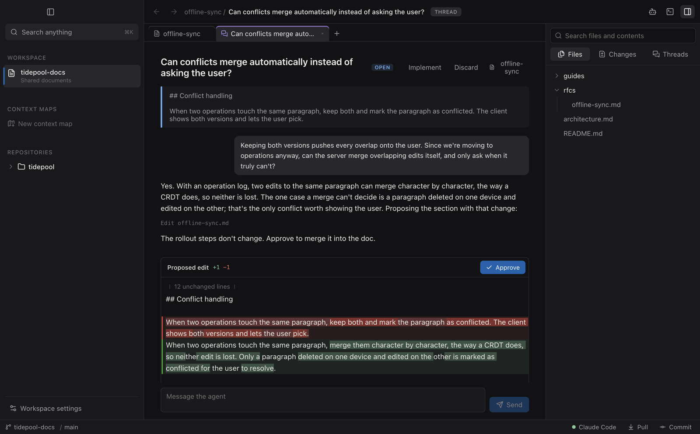
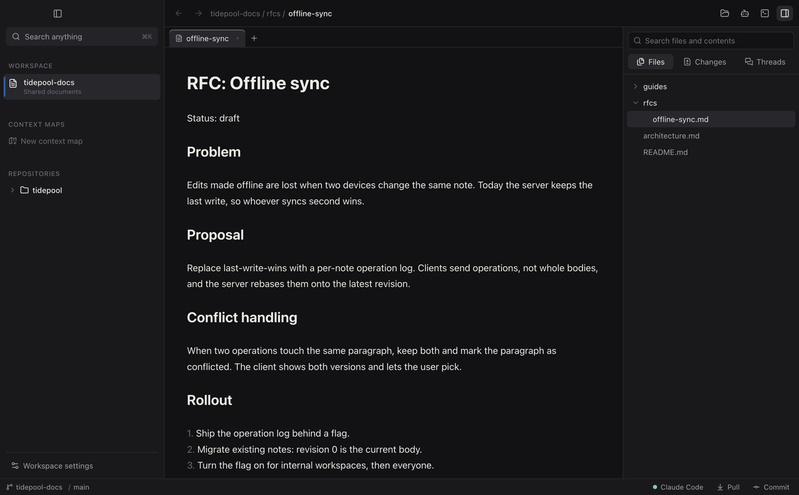
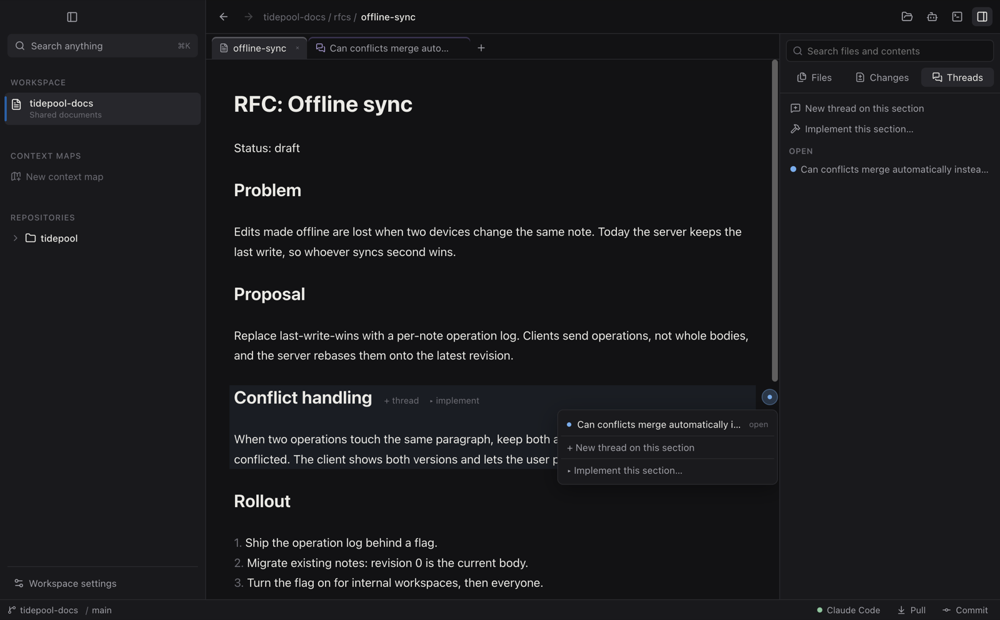
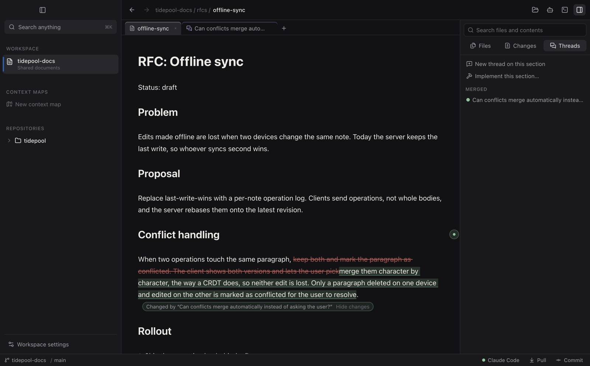
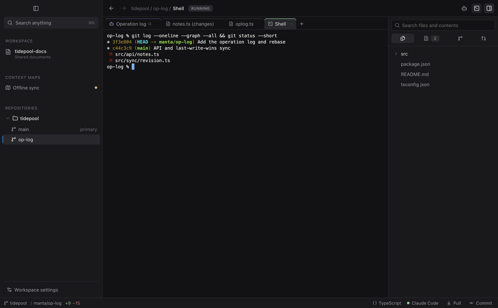
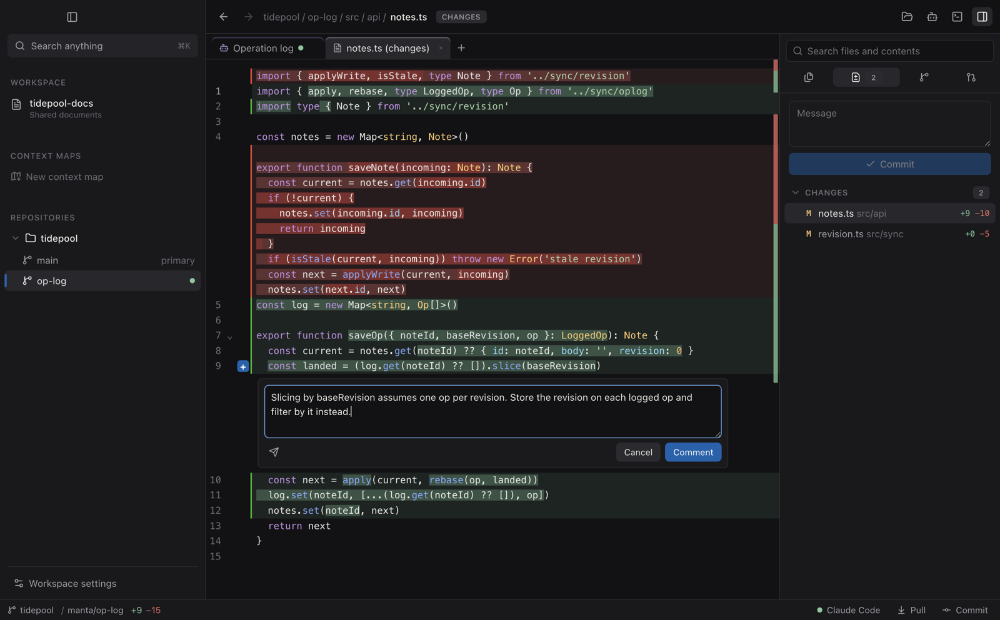
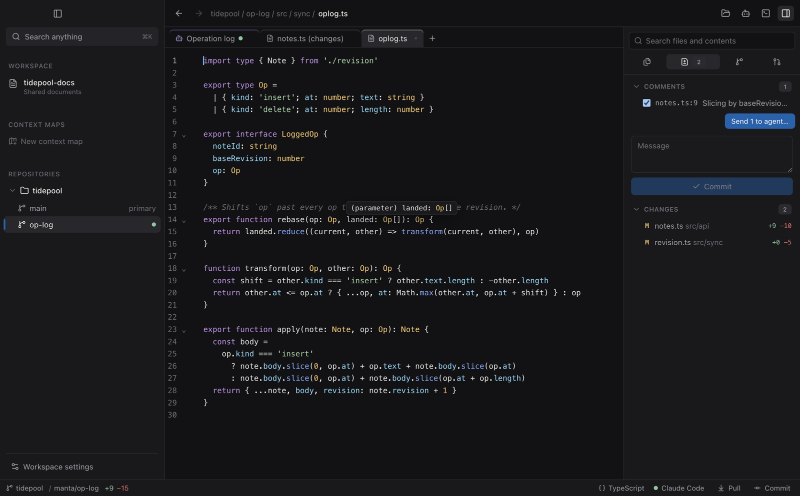
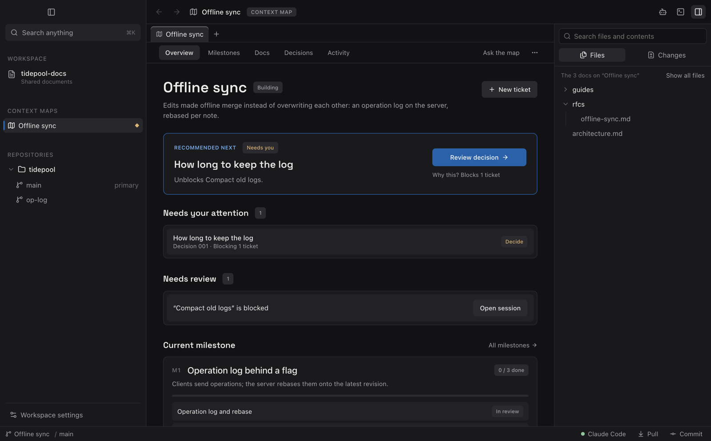
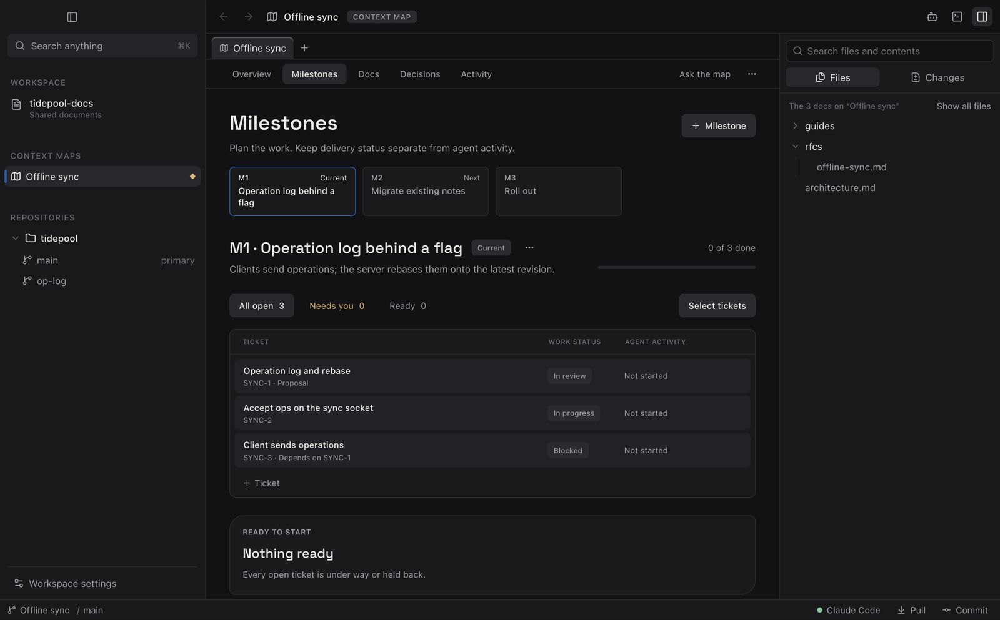
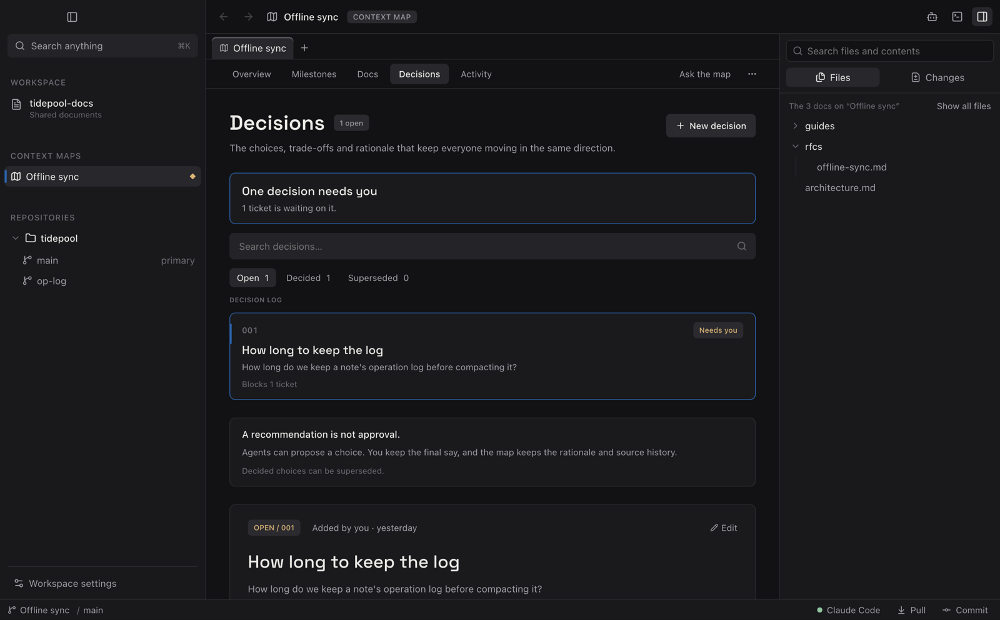

# Manta

**Living docs and an agentic workspace in one desktop app.**

Manta keeps a git repo of markdown docs next to your code repos. Every doc is backed by a CRDT, so text keeps its identity through edits from anywhere: the app, Obsidian, your IDE, a teammate's push. On top of that you can start agent **threads** on any section of a doc, approve their edits like a pull request, hand a section to a Claude Code session in its own **worktree**, and track a whole feature on a **context map**.



> **Status:** early and moving fast. Developed and used daily on macOS. The agent features run on your own [Claude Code](https://docs.anthropic.com/en/docs/claude-code) install and login; Manta has no account or server of its own.

## Contents

- [Features](#features)
  - [Living docs](#living-docs)
  - [Threads inside docs](#threads-inside-docs)
  - [Projects, worktrees and changes](#projects-worktrees-and-changes)
  - [Terminals and tracked Claude sessions](#terminals-and-tracked-claude-sessions)
  - [Implementation threads](#implementation-threads)
  - [Review comments and pull requests](#review-comments-and-pull-requests)
  - [The code editor](#the-code-editor)
  - [Context maps](#context-maps)
- [Install and run](#install-and-run)
- [Where your data lives](#where-your-data-lives)
- [Developing Manta](#developing-manta)
- [Limitations](#limitations)
- [License](#license)

## Features

Screenshots are from a demo workspace: a docs repo (`tidepool-docs`) and one code repo (`tidepool`).

### Living docs



Pick a git repo of markdown as your **docs repo**. Manta opens each file in a live-preview markdown editor (headings, lists, tables and code render in place; the markup shows where your cursor is).

**How it works**

- Every markdown file is backed by a [Yjs](https://yjs.dev) CRDT. Inside the app the CRDT is the source of truth; git is the record everyone else sees.
- When a file changes outside Manta (Obsidian, an IDE, `git pull` in a terminal), the watcher sees it differ from what Manta last wrote. Manta forks the CRDT at that write, replays `last written → disk` as minimal text operations, and merges the fork into the live doc. Unchanged text keeps its identity, so anything anchored to it (threads, change highlights) survives.
- **Commit** and **Pull** live in the status bar. Pull forks the CRDT at the last commit, replays `HEAD → upstream` as operations, merges, then fast-forwards git, so unpushed in-app edits survive as concurrent edits.
- CRDT state is stored in `.git/manta/`, out of your working tree.

Deep dive: [docs/living-docs.md](docs/living-docs.md).

### Threads inside docs

A thread is an agent conversation anchored to one section of a doc. Use it to scope an idea, rewrite a section, or ask questions against the doc's context.



1. Hover a heading and click **+ thread**, or use **New thread on this section** in the Threads panel.
2. Say what the thread should figure out. The agent (your own Claude Code) works on a **fork** of the doc and proposes an edit, shown as a diff (top screenshot).
3. **Approve** merges the fork into the doc and makes one commit for that doc, with a `Manta-Thread: <id>` trailer. Edits you made to the doc meanwhile survive the merge.
4. The doc then highlights what the thread changed, inserted text marked and removed text struck through, until you click **Hide changes**.



**How it works**

- **Anchors:** each thread is anchored by two relative positions in the doc's CRDT, so it follows its section through edits from any source. A deleted section leaves the thread detached, never removed.
- **The agent and its fence:** each turn writes the proposed doc to a private folder and runs your Claude Code there through the Agent SDK, with your plugins, MCP servers, skills, hooks and login. It can read anywhere; writes are fenced to the thread's folder (file tools by a `PreToolUse` hook, Bash by the OS sandbox). Anything else that needs permission shows as a card in the thread: **Allow**, **Always for this thread**, or **Deny**.
- **Subthreads:** a thread inside a thread. It edits a fork of the parent's fork; approving it merges into the parent's proposal, and the parent lands with its approved subthreads in one commit.
- **Records:** threads are saved in the docs repo's `.manta/threads/`, which Manta keeps out of git (`.git/info/exclude`) and out of every commit. Threads are never deleted.

Deep dive: [docs/threads.md](docs/threads.md).

### Projects, worktrees and changes

Add code repos from the **Repositories** header in the sidebar. Expand one to see its worktrees, and use **New worktree** to start isolated work on a `manta/<name>` branch. Each context (the docs repo, each worktree) has its own tabs, and switching contexts keeps them.

The right panel has, per worktree:

- **Files:** the tree, plus search across files and contents.
- **Changes:** stage, unstage, discard and commit, like VS Code's source control view; each file opens as a diff against `HEAD`.
- **Branch:** what's committed on the branch, compared against a branch you pick (remembered per worktree).
- **Pull request:** the branch's PR, its CI checks and comments (needs the [GitHub CLI](https://cli.github.com)).

A worktree Manta created can be removed from its row once it has no uncommitted or untracked files; its branch is kept. Back and forward (⌘[ / ⌘], or the mouse buttons) work across the whole app, even between worktrees.

### Terminals and tracked Claude sessions



In any context, **New Claude session** (⌘T) starts your own Claude Code in a terminal tab, and **New shell** opens your login shell.

**How it works**

- Manta starts Claude Code with its own hooks attached, so it knows whether each session is **working**, **waiting** for you (a permission or a question), or **idle** at its prompt. The tab and the worktree's sidebar row show that state.
- Terminal processes live in Electron's main process, not in the tab: switching context, closing the window or reloading never stops them. Only closing the tab, removing the worktree, or quitting Manta does.
- A Claude tab can resume its conversation after a relaunch (`--resume` with the session id Manta picked when it started).

Deep dive: [docs/terminals.md](docs/terminals.md).

### Implementation threads

From a doc section, **Implement this section…** starts a tracked Claude session in a code worktree (a new one or an existing one), linked both ways:

- The session gets a brief naming the doc, the section and the thread it came from, and can read the docs repo (`--add-dir`); its brief tells it not to edit it.
- Its tab shows an **Implementing `<doc>`** bar that opens the doc.
- The doc shows a status chip on the section: the branch, the PR once there is one, then **Landed** once it merges.
- The session can propose changes back to the doc (`propose_doc_change`), which arrive as threads you review, so the doc stays in step with what was built.

Deep dive: [docs/implementation-threads.md](docs/implementation-threads.md).

### Review comments and pull requests



- **Comment on any diff line:** click the **+** in a diff's margin (deleted lines included). Send the comment straight to a Claude session, or collect several in the right panel and **Send to agent…** as one message. The agent gets each comment with its file, line and surrounding hunk. These comments stay in Manta; they never go to GitHub.
- **The PR tab:** see the branch's pull request, CI checks and comments; send teammates' comments to an agent behind your own prompt template; **Create draft PR**.
- **PR review:** go through the PR's files ticking each as viewed, comment on lines, then **Finish review** (comment, approve or request changes).

Deep dive: [docs/reviews.md](docs/reviews.md).

### The code editor



The worktree editor is CodeMirror over the same CRDT as docs, so threads, diffs and outside edits work in code too.

- **Editing:** find and replace (⌘F), multiple cursors, folding, go to line, bracket matching, and **⌘P** / **⌘K** quick open with fuzzy matching (`name:42` opens at a line).
- **Language servers:** one per worktree and language, run in the main process. TypeScript and JavaScript are built in (TypeScript 7's native server): go to definition, hover types, errors as you type, completions, rename, references.
- **Format on save:** ⌘S formats with the project's own Prettier, Biome or Ruff (else the language server), applied as minimal edits so thread anchors survive.
- **Plugins:** the Plugins tab (from the **+** menu) installs language servers, linters and formatters from [Mason's registry](https://github.com/mason-org/mason-registry), VS Code colour themes from [Open VSX](https://open-vsx.org) for the code editor, and the built-in Armada theme for the whole app. Plugins are declarative: nothing they ship runs inside Manta.

Deep dive: [docs/code-editor.md](docs/code-editor.md).

### Context maps

A context map is the home for one feature or project: its docs, a plan of milestones and tickets, the decisions it waits on, and the agent sessions working on it.



- **Overview:** what to do next, what needs your attention, what needs review, and the current milestone.
- **Milestones:** tickets with acceptance criteria and what they wait for. Launch a ticket (or several that can run at once) in one click: each gets a worktree and a Claude session with a scoped brief and tools to query the rest of the map.
- **Docs:** the PRDs, RFCs and notes the work is built from, tied to milestones.
- **Decisions:** questions the work waits on, with options and a recommendation; tickets blocked by an open decision can't start.
- **Activity:** an event log of sessions starting and finishing, pull requests, and decisions.
- **Ask the map:** a conversation with an agent that knows the whole map; it can break the docs down into a plan or suggest docs, as proposals you accept.



**How it works**

- Status changes never wait for approval; docs and plans never change without it. Doc changes always arrive as threads, and plan changes as suggestions in **Needs review**.
- Launched sessions keep a journal and wrap up by reporting status and judging the acceptance criteria. A ticket is **in review** while its PR is open and **done** once merged and verified.
- Manta only starts agent runs on its own for two small jobs: a sweep that wraps up for sessions that didn't, and a landing pass that checks the docs once work lands. Both can be turned off per map. Checking pull requests asks `gh`, never an agent.
- Maps live in the docs repo's `.manta/maps/`, next to threads, out of git.



Deep dive: [docs/context-maps.md](docs/context-maps.md).

## Install and run

**You need:**

- macOS (the platform Manta is developed and tested on)
- [Node.js](https://nodejs.org) and npm
- git
- [Claude Code](https://docs.anthropic.com/en/docs/claude-code), installed and logged in, for threads, sessions and maps
- Optional: the [GitHub CLI](https://cli.github.com) (`gh`), logged in, for the pull request features

There are no prebuilt releases yet. Build and run from source:

```sh
git clone https://github.com/SheaGuev/Manta.git
cd Manta
npm install
npm run app   # build, then run Manta
```

On first launch, choose your **docs repo**: the top-level folder of a git repo of markdown (Manta offers to `git init` an empty folder). **Change docs repo…** in the Workspace header swaps it later. Add code repos with **+** on the Repositories header.

Agent features run your own Claude Code, so they use your Claude plan or API usage.

## Where your data lives

| What | Where |
|---|---|
| Your docs | The docs repo, as plain markdown in git |
| CRDT history of each doc | `<docs repo>/.git/manta/` |
| Threads and context maps | `<docs repo>/.manta/`, kept out of git and out of every commit |
| Projects, settings, terminals, managed worktrees | `~/Library/Application Support/manta` |
| Review comments | `<worktree git dir>/manta/review-comments.json` |

Set `MANTA_USER_DATA=/some/dir` to run an instance with its own projects and settings.

## Developing Manta

```sh
npm run dev         # hot reload, under its own profile (manta-dev); main/preload edits restart it
npm test            # vitest against real temp git repos; ~25 s
npm run typecheck
npm run build
```

`npm run dev` uses a separate profile (`~/Library/Application Support/manta-dev`) because a restart there ends every terminal, and should never take your real sessions with it.

Set `MANTA_FAKE_AGENT=1` to run with a scripted agent instead of Claude Code: tests and UI checks use it, so they spend no usage.

**Finding your way:**

- Every folder under `src/` has a `README.md` listing what each file does. Start at [src/README.md](src/README.md) for the process split and import rules.
- [docs/patterns.md](docs/patterns.md): code conventions (no `as` casts, guards for outside data, the serial queue, atomic writes).
- [docs/roadmap.md](docs/roadmap.md): what's built and what's next.
- [CLAUDE.md](CLAUDE.md): the rules agents working on this repo follow.

| Folder | What lives there |
|---|---|
| [`src/core/`](src/core/README.md) | All logic that touches disk, git, CRDTs and agents. Plain Node, no Electron, tested directly |
| [`src/main/`](src/main/README.md) | Electron main: window, file watchers, IPC handlers and argument validation |
| [`src/preload/`](src/preload/README.md) | `window.manta`, the bridge from IPC to the renderer |
| [`src/shared/`](src/shared/README.md) | IPC types and channels both sides agree on |
| [`src/renderer/src/`](src/renderer/src/README.md) | The React UI. No Node access |

The CDP-driven UI end-to-end scripts the docs mention aren't in the repo yet.

## Limitations

- Pull fast-forwards only; diverged history is refused.
- Files deleted or renamed outside the app aren't tracked yet.
- A block moved in an outside edit is seen as a delete plus an insert.
- Every write stores a full CRDT snapshot: fine for docs, not for huge files.
- Threads and maps are local to each machine for now. Sharing them through their own git ref is on the [roadmap](docs/roadmap.md).

## License

[MIT](LICENSE)
